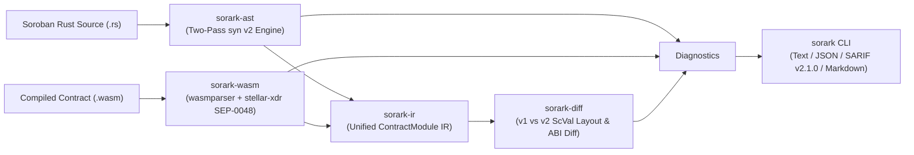

# SORARK (`sorark`)

[](https://github.com/sorark-labs/sorark/actions/workflows/ci.yml)
[](https://www.rust-lang.org/)
[](https://developers.stellar.org/)
[](https://www.drips.network/wave/stellar)
[](./LICENSE)

**SORARK** (`sorark`) is a pure-Rust static analysis, state-archival verification, and upgrade-compatibility engine built specifically for **Stellar Soroban** smart contracts.

Unlike generic syntax linters, **SORARK** models Soroban's exact **Three-Tier State Archival mechanics** (`Instance`, `Persistent`, `Temporary`), **64 KiB ledger entry limits**, and **`stellar-xdr` (`ScVal` / `ScMap` / `ScVec` / `ScSpecEntry`) binary serialization rules** across both Rust source code (`syn` AST) and compiled WebAssembly (`.wasm`) binaries.

---

## Why SORARK Exists (The Stellar Problem It Solves)

Soroban introduces two critical production failure modes that do not exist in EVM smart contracts:

1. **State Archival & The 64 KiB Instance Storage Bomb:**
   * All keys in `env.storage().instance()` share a **single 64 KiB (`65,536`-byte) ledger entry** loaded on every contract invocation. Storing a dynamically growing `Map`, `Vec`, `Bytes`, or a `#[contracttype]` struct that transitively embeds one inside `instance()` will permanently brick every entrypoint in the contract once the entry reaches 64 KiB.
   * Writing to `persistent()` or `instance()` without extending TTL (`extend_ttl`) leaves entries vulnerable to archival, while storing access-control keys (`Admin`, `Owner`, `Nonce`, `Balance`) in `temporary()` storage allows attackers to wait for TTL expiration (as short as 16 ledgers / ~80s) when the entry is permanently deleted.
2. **In-Place WASM Upgrades (`update_current_contract_wasm`) & `ScVal` Deserialization Traps:**
   * Soroban serializes named `#[contracttype]` structs on-chain as key-sorted `ScMap`s (keyed by `ScSymbol(field_name)`), tuple structs as positional `ScVec`s, and `DataKey` enums as tagged `ScSpecUdtUnionV0` vectors.
   * Renaming a struct field, changing a field type, shifting an enum discriminant, or altering a `DataKey` variant between `v1` and `v2` causes the Soroban host to trap when reading historical ledger entries after an in-place WASM upgrade.

---

## Architecture Overview



### Workspace Crates
| Crate | Responsibility |
| :--- | :--- |
| [`crates/sorark-ir`](./crates/sorark-ir) | Source-agnostic Soroban contract IR (`ContractModule`, `StructSpec`, `UnionSpec`, `TypeRef`), diagnostics, and `sorark.toml` configuration parser. |
| [`crates/sorark-ast`](./crates/sorark-ast) | Two-pass `syn` v2 static analyzer: Pass 1 resolves transitive `#[contracttype]` unboundedness and helper call graphs (`extend_ttl`, `require_auth`); Pass 2 evaluates `AstRule` checks. |
| [`crates/sorark-wasm`](./crates/sorark-wasm) | Binary `.wasm` inspector using `wasmparser` and official `stellar-xdr` to decode `contractspecv0`, `contractenvmetav0`, and `contractmetav0` custom sections. |
| [`crates/sorark-diff`](./crates/sorark-diff) | Upgrade compatibility engine comparing `old` (`v1`) and `new` (`v2`) contracts (across `.rs` or `.wasm` interchangeably) for `ScMap`/`ScVec` storage corruption and ABI breakage. |
| [`crates/sorark-cli`](./crates/sorark-cli) | Command-line interface (`sorark`) with `lint`, `diff`, `inspect`, `rules`, and `init` subcommands and 4 output formatters (`text`, `json`, `sarif`, `markdown`). |

---

## Quick Start (Under 2 Minutes)

### Prerequisites
* **Rust 1.85+ (2024 Edition)** (`rustup update stable`)

### Build & Run Against Bundled Soroban Example Contracts

```bash
# 1. Clone the repository
git clone https://github.com/sorark-labs/sorark.git
cd sorark

# 2. Run the full workspace test suite
cargo test --workspace

# 3. Lint the vulnerable Soroban vault example (catches storage bombs, missing TTL, & unprotected upgrades)
cargo run -p sorark-cli -- lint examples/vulnerable-vault

# 4. Lint the production-safe v1 vault contract (passes with 0 errors, 0 warnings)
cargo run -p sorark-cli -- --deny-warnings lint examples/upgrade-v1

# 5. Diff v1 against the broken v2 upgrade candidate (catches ScMap/DataKey corruption & ABI drift)
cargo run -p sorark-cli -- diff --old examples/upgrade-v1 --new examples/upgrade-v2-broken

# 6. Export findings in GitHub Code Scanning SARIF v2.1.0 or PR Markdown format
cargo run -p sorark-cli -- lint examples/vulnerable-vault --format sarif
cargo run -p sorark-cli -- diff --old examples/upgrade-v1 --new examples/upgrade-v2-broken --format markdown
```

---

## Built-In Rule Matrix (`sorark rules`)

| Rule ID | Category | Default Severity | Summary |
| :--- | :--- | :--- | :--- |
| **`ARK-STOR-001`** | `storage-safety` | **Error** | Unbounded collection (`Map`, `Vec`, `Bytes`, `String`) or transitive struct stored in `env.storage().instance()` (64 KiB brick hazard). |
| **`ARK-STOR-002`** | `state-archival` | **Warning** | Entrypoint mutates `persistent()` or `instance()` storage without calling `extend_ttl` directly or via a local helper function. |
| **`ARK-STOR-003`** | `storage-safety` | **Error** | Security-critical state key (`Admin`, `Owner`, `Balance`, `Allowance`, `Nonce`, `Paused`, `Role`) written to ephemeral `temporary()` storage. |
| **`ARK-STOR-004`** | `state-archival` | **Error** | Invalid `extend_ttl(threshold, extend_to)` bounds (`threshold > extend_to` host trap, `extend_to == 0`, or `> 3,110,400` Mainnet `max_entry_ttl`). |
| **`ARK-UPG-001`** | `upgrade-auth` | **Error** | `env.deployer().update_current_contract_wasm(...)` invoked without a dominating `require_auth()` check. |
| **`ARK-UPG-002`** | `upgrade-auth` | **Info** | Stateful contract defines administrative storage mutations but exposes no `update_current_contract_wasm` upgrade handler. |
| **`ARK-WASM-001`** | `resource-budget` | **Warning** | Compiled `.wasm` binary exceeds ledger byte budget (48 KiB warning / 64 KiB limit) or lacks SEP-0048 `contractspecv0` / `contractenvmetav0` sections. |
| **`ARK-DIFF-001`** | `storage-compatibility` | **Error** | Incompatible `#[contracttype]` struct (`ScMap`) field removal/rename/type change or positional tuple struct (`ScVec`) mutation between `v1` and `v2`. |
| **`ARK-DIFF-002`** | `storage-compatibility` | **Error** | Incompatible `#[contracttype]` enum (`ScSpecUdtEnumV0`) discriminant shift or tagged union (`ScSpecUdtUnionV0`) `DataKey` payload mutation. |
| **`ARK-DIFF-003`** | `abi-compatibility` | **Warning** | Breaking public contract entrypoint signature change (removed function, altered parameter types, or changed return type). |
| **`ARK-DIFF-004`** | `abi-compatibility` | **Warning** | Mutated or removed `#[contracterror]` variant or shifted numeric error code (`ScSpecUdtErrorEnumV0`). |
| **`ARK-DIFF-005`** | `abi-compatibility` | **Warning** | Soroban environment protocol version regression or jump in `contractenvmetav0` between `v1` and `v2` WASM builds. |

---

## Inline Suppressions & Configuration (`sorark.toml`)

Generate a default `sorark.toml` config in any Soroban project:

```bash
sorark init
```

To suppress a specific rule on an intentional line in Rust source code, add an inline comment:

```rust
// sorark-ignore: ARK-STOR-002 -- rent is managed by an external keeper bot
env.storage().persistent().set(&DataKey::Order(id), &order);
```

---

## Contributing & Drips Stellar Wave

We actively participate in the **[Drips Stellar Wave Program](https://www.drips.network/wave/stellar)**!
* Read [`CONTRIBUTING.md`](./CONTRIBUTING.md) for local setup, architecture guidelines, and how to add a new `AstRule` or `DiffRule` in an isolated file.
* Browse [`DRIPS_WAVE.md`](./DRIPS_WAVE.md) for our curated backlog of **100-point (Trivial)**, **150-point (Medium)**, and **200-point (High)** Wave tasks.

## License

Licensed under either of **MIT License** ([`LICENSE`](./LICENSE)) or **Apache License, Version 2.0** at your option.

