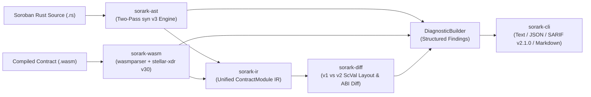

# SORARK (`sorark`)

[](https://github.com/sorark-labs/sorark/actions/workflows/ci.yml)
[](https://github.com/sorark-labs/sorark/releases/tag/v0.1.0)
[-orange.svg)](https://www.rust-lang.org/)
[](https://developers.stellar.org/)
[](https://www.drips.network/wave/stellar)
[](./LICENSE)

**SORARK** (`sorark`) is a production-grade, pure-Rust static analysis, **State Archival** verification, and **in-place WASM upgrade compatibility** engine built specifically for **Stellar Soroban** smart contracts.

Unlike generic Rust syntax linters, **SORARK** models Soroban's exact **Three-Tier State Archival mechanics** (`Instance`, `Persistent`, `Temporary`), **64 KiB ledger entry limits**, and **`stellar-xdr` v30 (`ScVal` / `ScMap` / `ScVec` / `ScSpecEntry`) binary serialization rules** across both Rust source code (`syn` v3 AST) and compiled WebAssembly (`.wasm`) binaries.

---

## Table of Contents

- [Why SORARK Exists (The Stellar Problem It Solves)](#why-sorark-exists-the-stellar-problem-it-solves)
- [Architecture & Modular Workspace Layout](#architecture--modular-workspace-layout)
- [Quick Start (Under 2 Minutes)](#quick-start-under-2-minutes)
- [Real CLI Output Examples](#real-cli-output-examples)
- [CLI Command & Exit-Code Reference](#cli-command--exit-code-reference)
- [Built-In Rule Matrix (`sorark rules`)](#built-in-rule-matrix-sorark-rules)
- [Configuration (`sorark.toml`) & Inline Suppressions](#configuration-sorarktoml--inline-suppressions)
- [Bundled `#![no_std]` Soroban Example Contracts](#bundled-no_std-soroban-example-contracts)
- [Contributing & Drips Stellar Wave](#contributing--drips-stellar-wave)

---

## Why SORARK Exists (The Stellar Problem It Solves)

Stellar Soroban smart contracts have two unique, consensus-enforced failure modes that do not exist in EVM or CosmWasm environments:

### 1. Three-Tier State Archival & The 64 KiB Instance Storage Bomb
* **64 KiB Instance Storage Ceiling (`ARK-STOR-001`):** Every key stored via `env.storage().instance()` shares **one single `ContractData` ledger entry** alongside the contract instance itself, capped at **64 KiB (`65,536` bytes)** on Stellar Mainnet and loaded into memory on *every* invocation. Storing an unbounded `Vec<T>`, `Map<K, V>`, `Bytes`, `String`, or a `#[contracttype]` struct that transitively embeds one inside `instance()` creates a time-bomb: once the shared entry exceeds 64 KiB, **every function in the contract permanently traps**.
* **Missing TTL Extensions (`ARK-STOR-002`) & Invalid Bounds (`ARK-STOR-004`):** Writing to `persistent()` or `instance()` without extending time-to-live via `extend_ttl(threshold, extend_to)` leaves state vulnerable to archival, while passing `threshold > extend_to` or `extend_to > 3,110,400` (`max_entry_ttl`) triggers an immediate Soroban host trap.
* **Ephemeral `Temporary` Storage Exploits (`ARK-STOR-003`):** `env.storage().temporary()` is designed strictly for replaceable caches and price quotes. When a `temporary()` entry's TTL expires (minimum 16 ledgers / ~80 seconds), it is **permanently deleted from the ledger** and cannot be restored. Storing `Admin`, `Owner`, `Balance`, `Nonce`, or `Paused` state in `temporary()` allows an attacker to wait for TTL expiration and bypass access control or re-initialize the contract.

### 2. In-Place WASM Upgrades (`update_current_contract_wasm`) & `ScVal` Deserialization Traps
* Soroban serializes named `#[contracttype]` structs on-chain as key-sorted `ScMap`s (keyed by `ScSymbol(field_name)`), positional tuple structs as `ScVec`s, integer enums as `ScVal::U32` (`ScSpecUdtEnumV0`), and `DataKey` enums with tuple payloads as tagged `ScSpecUdtUnionV0` vectors (`[ScSymbol(variant_name), ...payload]`).
* If a `v2` upgrade renames a struct field, adds a required field without migration, changes a field's type, shifts an enum discriminant, or alters a `DataKey` variant payload, calling `env.deployer().update_current_contract_wasm(new_wasm_hash)` succeeds—but subsequent calls that read historical `v1` ledger entries **trap at host deserialization time**.

---

## Architecture & Modular Workspace Layout



### Workspace Crates & Module Hierarchy

```text
sorark/
├── crates/
│   ├── sorark-ir/                  # Source-agnostic IR, Diagnostics & Config
│   │   └── src/
│   │       ├── model/              # ContractModule, TypeRef, SourceOrigin, UnboundedAnalyzer
│   │       ├── diagnostic/         # Diagnostic, DiagnosticBuilder, Severity, SourceSpan, Catalog
│   │       └── config/             # SorarkConfig (sorark.toml) & Stellar Mainnet ledger limits
│   ├── sorark-ast/                 # Two-Pass Rust AST Static Analyzer (syn v3)
│   │   └── src/
│   │       ├── parser/             # Pass 1: context, items, body visitor, const_eval, suppressions
│   │       ├── rules/              # Pass 2: isolated single-rule modules (ARK-STOR-*, ARK-UPG-*)
│   │       └── scanner.rs          # Recursive workspace .rs discovery & rule runner
│   ├── sorark-wasm/                # WebAssembly & SEP-0048 XDR Binary Inspector
│   │   └── src/
│   │       ├── sections.rs         # wasmparser visitor & contractspecv0/envmetav0/metav0 decoders
│   │       ├── convert.rs          # stellar-xdr ScSpecEntry -> sorark-ir ContractModule converter
│   │       ├── budget.rs           # ARK-WASM-001 64 KiB ledger ceiling & custom section checks
│   │       └── fixture.rs          # Synthetic SEP-0048 .wasm encoder for deterministic testing
│   ├── sorark-diff/                # v1-to-v2 Storage-Layout & ABI Upgrade Compatibility Engine
│   │   └── src/
│   │       ├── rule.rs             # DiffRule trait & default rule registry
│   │       ├── report.rs           # DiffReport & compare_contract_modules
│   │       └── rules/              # Isolated diff rules (struct_layout, enum_union, function_abi, ...)
│   └── sorark-cli/                 # Command-Line Interface (`sorark`)
│       └── src/
│           ├── cli.rs              # Clap CLI definition (lint, diff, inspect, rules, init)
│           ├── commands.rs         # Subcommand execution handlers & exit-code logic
│           └── format/             # Output formatters (text, json, sarif v2.1.0, markdown, inspect)
└── examples/                       # Real #![no_std] Soroban smart contracts (soroban-sdk v22)
    ├── vulnerable-vault/           # Deliberately exhibits storage bombs, missing TTL & open upgrade
    ├── upgrade-v1/                 # Production-safe baseline vault (passes --deny-warnings)
    └── upgrade-v2-broken/          # Incompatible v2 upgrade candidate for `sorark diff`
```

---

## Quick Start (Under 2 Minutes)

### Prerequisites
* **Rust `1.87+` (2024 Edition)** (`rustup update stable`)

### Install the `sorark` CLI Globally (Optional)

```bash
cargo install --git https://github.com/sorark-labs/sorark sorark-cli
sorark --version
```

### Build & Run Against Bundled Soroban Contracts

```bash
# 1. Clone the repository
git clone https://github.com/sorark-labs/sorark.git
cd sorark

# 2. Run all unit, integration, and doc tests across the workspace
cargo test --workspace

# 3. Lint the vulnerable Soroban vault example
cargo run -p sorark-cli -- lint examples/vulnerable-vault

# 4. Verify the production-safe v1 vault contract passes with 0 errors and 0 warnings
cargo run -p sorark-cli -- --deny-warnings lint examples/upgrade-v1

# 5. Diff v1 against the broken v2 upgrade candidate (.rs or .wasm interchangeably)
cargo run -p sorark-cli -- diff --old examples/upgrade-v1 --new examples/upgrade-v2-broken

# 6. Export findings in GitHub Code Scanning SARIF v2.1.0 or PR Markdown format
cargo run -p sorark-cli -- lint examples/vulnerable-vault --format sarif
cargo run -p sorark-cli -- diff --old examples/upgrade-v1 --new examples/upgrade-v2-broken --format markdown
```

---

## Real CLI Output Examples

### 1. Static Storage & Archival Analysis (`sorark lint`)

```text
$ sorark lint examples/vulnerable-vault

error[ARK-STOR-001]: Unbounded Type Stored in Instance Storage
  --> examples/vulnerable-vault/src/lib.rs:28:9
   |
28 |         env.storage().instance().set(&DataKey::State, &state);
   |
   = note: Function `initialize` writes key `&DataKey::State` with unbounded value type `VaultState` into `env.storage().instance()`. All `instance()` keys share a single 64 KiB ledger entry loaded on every contract call; unbounded growth will permanently brick the contract.
   = help: Move dynamically sized data (`Vec`, `Map`, `Bytes`, `String`, or structs containing them) into `env.storage().persistent()` with per-item `DataKey` variants.

error[ARK-STOR-003]: Security-Critical State Stored in Temporary Storage
  --> examples/vulnerable-vault/src/lib.rs:30:9
   |
30 |         env.storage().temporary().set(&DataKey::TempAdmin, &admin);
   |
   = note: Function `initialize` writes sensitive key `&DataKey::TempAdmin` to `env.storage().temporary()`. When a `temporary()` TTL expires, the entry is permanently deleted from the ledger and cannot be restored, enabling re-initialization or authorization bypass attacks.
   = help: Store administrative, balance, allowance, and nonce keys in `env.storage().instance()` or `env.storage().persistent()`.

error[ARK-STOR-004]: Invalid or Trap-Inducing `extend_ttl` Ledger Bounds
  --> examples/vulnerable-vault/src/lib.rs:37:9
   |
37 |         env.storage().instance().extend_ttl(50_000, 10_000);
   |
   = note: In `bad_ttl_extension`, `extend_ttl` is called with `threshold` (50000 ledgers) > `extend_to` (10000 ledgers). The Soroban host environment will trap at runtime.
   = help: Ensure `threshold <= extend_to` (typically `threshold = extend_to / 2` or `extend_to - DAY_IN_LEDGERS`).

error[ARK-UPG-001]: Unprotected Contract WASM Upgrade (`update_current_contract_wasm`)
  --> examples/vulnerable-vault/src/lib.rs:42:9
   |
42 |         env.deployer().update_current_contract_wasm(new_wasm_hash);
   |
   = note: Function `upgrade` invokes `update_current_contract_wasm` without calling `require_auth()` (directly or via a helper function). Any network account can replace the contract bytecode.
   = help: Load the stored admin `Address` from `instance()` or `persistent()` storage and invoke `admin.require_auth()` before `update_current_contract_wasm`.
```

### 2. Upgrade Compatibility Diff (`sorark diff --old v1 --new v2`)

```text
$ sorark diff --old examples/upgrade-v1 --new examples/upgrade-v2-broken

error[ARK-DIFF-001]: Incompatible #[contracttype] Struct Storage Layout Mutation
  --> examples/upgrade-v2-broken/src/lib.rs:10:1
   |
   = note: Field `VaultPosition.collateral` (type `I128`) was removed or renamed in v2. Because Soroban serializes named `#[contracttype]` structs as `ScMap` keyed by `ScSymbol("collateral")`, reading or migrating historical entries without this key breaks storage compatibility.
   = help: Retain field `VaultPosition.collateral: I128` or introduce a versioned struct (`VaultPositionV2`) and migrate state explicitly.

error[ARK-DIFF-002]: Incompatible #[contracttype] Enum or Tagged Union Mutation
  --> examples/upgrade-v2-broken/src/lib.rs:18:1
   |
   = note: Union/DataKey variant `DataKey::Position` changed payload layout from `(Address)` in v1 to `(Address, U32)` in v2, breaking ledger key lookup and deserialization.
   = help: Create a new variant (e.g. `DataKey::PositionV2(...)`) rather than mutating `DataKey::Position` in place.

warning[ARK-DIFF-003]: Breaking Public Contract Entrypoint Signature Change
  --> examples/upgrade-v2-broken/src/lib.rs:36:5
   |
   = note: Entrypoint `deposit` changed parameters from `(user: Address, amount: I128)` in v1 to `(user: Address, amount: U64)` in v2.
   = help: Add a new versioned entrypoint (e.g. `deposit_v2`) if callers still depend on `deposit`.
```

---

## CLI Command & Exit-Code Reference

```text
sorark [OPTIONS] <COMMAND>

Global Options:
  --config <PATH>    Path to an optional `sorark.toml` configuration file
  --deny-warnings    Treat warning-level diagnostics as non-zero exit code failures
  -h, --help         Print help
  -V, --version      Print version
```

| Subcommand | Usage | Description |
| :--- | :--- | :--- |
| **`lint`** | `sorark lint [PATH] [--format <FMT>] [--rule <ID>]` | Analyzes a Soroban Rust directory, `.rs` file, or compiled `.wasm` binary for storage-tier, TTL, and upgrade-auth hazards. |
| **`diff`** | `sorark diff --old <V1> --new <V2> [--format <FMT>]` | Compares `v1` and `v2` contracts (Rust source or `.wasm` binaries in any combination) for `ScVal` storage layout corruption and ABI breakages. |
| **`inspect`** | `sorark inspect <WASM> [--format <FMT>]` | Decodes a `.wasm` binary's SEP-0048 `contractspecv0`, `contractenvmetav0`, and `contractmetav0` XDR sections and checks the 64 KiB ledger byte budget. |
| **`rules`** | `sorark rules [--format <FMT>]` | Lists all 12 built-in analysis rules, categories, default severities, and remediations. |
| **`init`** | `sorark init [--output <PATH>] [--force]` | Generates a documented `sorark.toml` configuration file in the project root. |

### Deterministic CI Exit Codes
* **`0`**: Analysis completed cleanly with no blocking diagnostics.
* **`1`**: One or more `Error` diagnostics were emitted (or `Warning` diagnostics when `--deny-warnings` / `fail_on_warnings = true` is active).
* **`2`**: Invalid CLI arguments, unreadable path, syntax error, or malformed configuration file.

---

## Built-In Rule Matrix (`sorark rules`)

| Rule ID | Category | Default Severity | Engine | Summary |
| :--- | :--- | :--- | :--- | :--- |
| **`ARK-STOR-001`** | `storage-safety` | **Error** | `sorark-ast` | Unbounded collection (`Map`, `Vec`, `Bytes`, `String`) or transitive `#[contracttype]` struct stored in `env.storage().instance()` (64 KiB brick hazard). |
| **`ARK-STOR-002`** | `state-archival` | **Warning** | `sorark-ast` | Entrypoint mutates `persistent()` or `instance()` storage without calling `extend_ttl` directly or via a local helper function. |
| **`ARK-STOR-003`** | `storage-safety` | **Error** | `sorark-ast` | Security-critical state key (`Admin`, `Owner`, `Balance`, `Allowance`, `Nonce`, `Paused`, `Role`) written to ephemeral `temporary()` storage. |
| **`ARK-STOR-004`** | `state-archival` | **Error** | `sorark-ast` | Invalid `extend_ttl(threshold, extend_to)` bounds (`threshold > extend_to` host trap, `extend_to == 0`, or `> 3,110,400` Mainnet `max_entry_ttl`). |
| **`ARK-UPG-001`** | `upgrade-auth` | **Error** | `sorark-ast` | `env.deployer().update_current_contract_wasm(...)` invoked without a dominating `require_auth()` check. |
| **`ARK-UPG-002`** | `upgrade-auth` | **Info** | `sorark-ast` | Stateful contract defines administrative storage mutations but exposes no `update_current_contract_wasm` upgrade handler. |
| **`ARK-WASM-001`** | `resource-budget` | **Warning / Error** | `sorark-wasm` | Compiled `.wasm` binary exceeds ledger byte budget (48 KiB warning / 64 KiB error) or lacks SEP-0048 `contractspecv0` / `contractenvmetav0` sections. |
| **`ARK-DIFF-001`** | `storage-compatibility` | **Error** | `sorark-diff` | Incompatible `#[contracttype]` struct (`ScMap`) field removal/rename/type change or positional tuple struct (`ScVec`) mutation between `v1` and `v2`. |
| **`ARK-DIFF-002`** | `storage-compatibility` | **Error** | `sorark-diff` | Incompatible `#[contracttype]` enum (`ScSpecUdtEnumV0`) discriminant shift or tagged union (`ScSpecUdtUnionV0`) `DataKey` payload mutation. |
| **`ARK-DIFF-003`** | `abi-compatibility` | **Warning** | `sorark-diff` | Breaking public contract entrypoint signature change (removed function, altered parameter types, or changed return type). |
| **`ARK-DIFF-004`** | `abi-compatibility` | **Warning** | `sorark-diff` | Mutated or removed `#[contracterror]` variant or shifted numeric error code (`ScSpecUdtErrorEnumV0`). |
| **`ARK-DIFF-005`** | `abi-compatibility` | **Warning / Error** | `sorark-diff` | Soroban environment protocol version regression (`Error`) or advance (`Info`) in `contractenvmetav0` between `v1` and `v2` WASM builds. |

---

## Configuration (`sorark.toml`) & Inline Suppressions

Generate a documented configuration file in your Soroban workspace:

```bash
sorark init
```

```toml
# sorark.toml — SORARK Configuration for Stellar Soroban Smart Contracts
fail_on_warnings = false
min_persistent_ttl_ledgers = 17280      # ~1 day at 5s/ledger
min_temp_ttl_ledgers = 16               # Stellar Mainnet minimum temporary TTL
max_entry_ttl_ledgers = 3110400         # Stellar Mainnet maximum TTL (~180 days)
wasm_warn_bytes = 49152                 # 48 KiB warning threshold
wasm_max_bytes = 65536                  # 64 KiB Stellar Mainnet ledger entry limit
disabled_rules = []
exclude_paths = ["target", ".git", "node_modules"]
sensitive_key_patterns = [
    "admin", "owner", "governor", "pauser", "guardian",
    "balance", "supply", "total_supply", "allowance",
    "nonce", "initialized", "paused", "role", " council",
]
```

### Inline Rule Suppressions

To suppress a specific rule on an intentional line in Rust source code, place a `// sorark-ignore:` comment on the same line or the immediately preceding line:

```rust
// sorark-ignore: ARK-STOR-002 -- TTL is extended once per batch by the router contract
env.storage().persistent().set(&DataKey::Order(id), &order);
```

---

## Bundled `#![no_std]` Soroban Example Contracts

| Example Contract | Path | Purpose |
| :--- | :--- | :--- |
| **`vulnerable-vault`** | [`examples/vulnerable-vault`](./examples/vulnerable-vault) | Demonstrates `ARK-STOR-001` (transitive `Map` inside `instance()`), `ARK-STOR-002` (missing `extend_ttl`), `ARK-STOR-003` (`TempAdmin` in `temporary()`), `ARK-STOR-004` (`threshold > extend_to` trap), and `ARK-UPG-001` (unauthenticated `update_current_contract_wasm`). |
| **`upgrade-v1`** | [`examples/upgrade-v1`](./examples/upgrade-v1) | Production-safe Soroban vault contract with proper `persistent()` per-user keys, helper-delegated `extend_ttl`, and authenticated admin upgrades. Passes `sorark --deny-warnings lint`. |
| **`upgrade-v2-broken`** | [`examples/upgrade-v2-broken`](./examples/upgrade-v2-broken) | Candidate `v2` upgrade containing `ScMap` field renames, `DataKey` union payload mutations, shifted `#[contracterror]` codes, and altered entrypoint parameters for testing `sorark diff`. |

---

## Contributing & Drips Stellar Wave

We actively participate in the **[Drips Stellar Wave Program](https://www.drips.network/wave/stellar)**!
* Read [`CONTRIBUTING.md`](./CONTRIBUTING.md) for local setup, Rust 2024 coding standards, and step-by-step instructions on adding a new `AstRule` or `DiffRule` in its own isolated module.
* Browse [`DRIPS_WAVE.md`](./DRIPS_WAVE.md) for our curated backlog of **18 pre-scoped Wave tasks** across **100-point (Trivial)**, **150-point (Medium)**, and **200-point (High)** tiers.

## License

Licensed under either of **MIT License** ([`LICENSE`](./LICENSE)) or **Apache License, Version 2.0** at your option.
